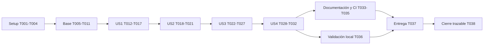

# Tasks: Página de inicio pública de Mikuna

## Ampliación visual solicitada el 2026-11-13

El alcance vigente está en [ampliacion-visual.md](ampliacion-visual.md). Estas tareas agregan el
diseño autorizado sin dar por ejecutadas las tareas anteriores de aceptación y entrega.

- [X] T039 Documentar INICIO-021 a INICIO-026 y la sustitución de las restricciones originales.
- [X] T040 Integrar las cuatro páginas con navegación pública y footer, conservando la portada.
- [X] T041 Copiar las diez fotos, registrar su procedencia y asignarlas a su sección correspondiente.
- [X] T042 Aplicar Ayacucho fijo, pasos sin flechas y cierres distintos con los seis colores aprobados.
- [X] T043 Compilar la aplicación con `pnpm.cmd build`; sin instalar dependencias ni ejecutar Playwright.
- [ ] T044 En la validación final, adaptar la suite al nuevo alcance y revisar visualmente las cinco secciones continuas vigentes.
- [X] T045 Sustituir el intercambio de vistas por un documento con anclas, encabezado persistente y navegación activa al desplazarse.
- [X] T046 Añadir Sobre nosotros al recorrido, menú y footer; colocar Restaurantes al final.
- [X] T047 Ajustar las secciones nuevas al alto disponible de escritorio; conservar portada y botones, restaurando el texto blanco de Pedir ahora.
- [X] T048 Retirar el listado de Restaurantes, ejemplos y enlaces; conservar los botones de pedido con el aviso de próxima disponibilidad.
- [X] T049 Diferenciar Sé repartidor de Para restaurantes con fondo melocotón, tarjetas blancas y separación naranja; compilar sin ejecutar Playwright.
- [X] T050 Corregir el crecimiento flex de las cabeceras de Cómo funciona, Para restaurantes y Sé repartidor; aplicar ancho y centrado del inicio, conservando la portada y compilando sin Playwright.

Las referencias a trece avisos, ausencia de footer y opciones sin navegación que aparecen debajo
describen el alcance inicial; la ampliación autorizada las sustituye. T017, T021, T026, T027,
T032, T035, T036 y T037 conservan sus pendientes de aceptación o entrega.

**Input**: Documentos de `specs/001-inicio-publico/`, actualizados con las imágenes aportadas.

**Prerequisites**: [plan.md](plan.md), [spec.md](spec.md), [research.md](research.md),
[data-model.md](data-model.md), [contrato UI](contracts/ui-home.md) y
[contrato de recursos](contracts/visual-assets.md).

**Tests**: Solicitados por la especificación y la constitución; Playwright fue confirmado por el
usuario. Las tareas de prueba comprueban requisitos observables y fallos relevantes, sin pruebas
triviales de constantes ni cobertura de negocio ficticia.

**Organization**: Las historias siguen el orden US1 (P1), US2 (P2), US3 (P2), US4 (P2).
Las casillas marcadas registran los artefactos implementados. Las ejecuciones y revisiones
pendientes conservan su casilla abierta y se detallan en [validation.md](validation.md).

## Format: `[ID] [P?] [Story] Description`

- Cada tarea comienza con casilla, identificador secuencial y descripción con ruta concreta.
- `[P]` permite trabajo paralelo solo después de sus dependencias y en archivos diferentes.
- `[US1]` a `[US4]` identifican la historia. Setup, base y cierre no llevan historia.
- Los tests de cada historia se escriben antes de su implementación y registran los fallos
  observables pendientes; no se provoca un error de compilación para simular un caso negativo.

## Path Conventions

Las rutas son relativas a la raíz `C:\BACK\Mikuna`. Aplicación en `frontend/`; documentos en
`specs/001-inicio-publico/`. Las fuentes gráficas reales son `docs/diseno/` y
`docs/seis_categorías/` (con tilde). Se utilizan tres fotografías del hero, seis fotografías
específicas de categorías y el logo, ya existentes. Los originales no se modifican y no hay
trabajo de generación de imágenes. Autenticación, catálogo, restaurantes, pedidos y pagos quedan
fuera. Los identificadores de estas tareas no crean requisitos RF de la propuesta.

## Phase 1: Setup (Shared Infrastructure)

**Purpose**: Aprovechar el frontend existente y preparar herramientas, recursos y configuración reproducibles.

- [X] T001 Añadir la versión exacta `@playwright/test@1.65.0` y `packageManager` pnpm 12.4.2 en `frontend/package.json`, actualizar `frontend/pnpm-lock.yaml` y definir los scripts de pruebas; conservar React, TypeScript, Vite y Tailwind actuales. Usar `pnpm.cmd` en PowerShell.
- [X] T002 Crear `frontend/tsconfig.e2e.json` para comprobar tipos de `frontend/playwright.config.ts` y `frontend/tests/e2e/`, y adaptar `frontend/eslint.config.js` a esos archivos sin añadir otro ejecutor o biblioteca de estilos; depende de T001.
- [X] T003 [P] Copiar el logo y las nueve fotografías existentes de `docs/diseno/` y `docs/seis_categorías/` a `frontend/src/assets/branding/logo-mikuna.png` y `frontend/src/assets/home/`, con los diez mapeos exactos de `specs/001-inicio-publico/contracts/visual-assets.md`; usar rutas literales, conservar los originales y comprobar huellas coincidentes. No generar imágenes nuevas ni reutilizar la hamburguesa del hero como imagen de categoría.
- [X] T004 Crear `frontend/playwright.config.ts` con Chromium y proyectos `mobile-320`, `mobile-390`, `tablet-768`, `tablet-1024`, `desktop-1440`, `desktop-1536`, sus seis ventanas exactas, informes y trazas de fallos; configurar preview de `dist` en `127.0.0.1:4173` con puerto estricto, sin recompilar otro artefacto dentro del servidor. Depende de T001-T002.

**Checkpoint**: Herramientas y fuentes preparadas; la copia de imágenes no equivale a validación visual final.

---

## Phase 2: Foundational (Blocking Prerequisites)

**Purpose**: Preparar contratos de tipos, contenido común, imágenes, estilos y estado de interfaz para las historias. Completar esta fase antes de integrar sus componentes.

- [X] T005 [P] Definir NavigationItem, ActionItem, CategoryItem, VisualAsset y contratos de estado/props compartidos en `frontend/src/features/home/home-types.ts`, sin entidades de negocio, router o persistencia. Para navegación conservar literalmente estas restricciones: id: «Único dentro de la página; no depende del texto mostrado.»; label: «Rótulo exacto de la spec.»; order: «Orden estable en escritorio y navegación agrupada.»; behavior: «Inicio y logo usan `home`; los otros accesos usan `coming-soon`.»; appearance: «Presentación; no cambia el comportamiento.».
- [X] T006 [P] Configurar en `frontend/src/index.css` los seis tokens `@theme`: índigo `#11094C`, naranja `#FF5A1F`, marfil `#FDF8F4`, melocotón `#FDE8D8`, gris `#464B53` y blanco `#FFFFFF`; mantener el import de Tailwind, tipografía local sin serifas, estilos globales mínimos y foco perceptible. No reinstalar Tailwind ni introducir configuración v3.
- [X] T007 Crear el manifiesto tipado `frontend/src/features/home/home-assets.ts` con importaciones de las nueve fotografías y el logo copiados en T003, conservando fuentes y medidas del contrato. Aplicar literalmente las restricciones de VisualAsset: id: «Nombre estable del recurso, según el contrato de recursos.»; source: «URL resuelta por el build; no URL remota de demostración.»; subject: «Alimento o logo que representa.»; alternativeText: «Descripción pertinente; sin nombres de archivo ni texto promocional incrustado.»; width y height: «Se registran al copiar el archivo y permiten reservar su proporción.»; provenance: «Ruta original de `docs/diseno/` o `docs/seis_categorías/`, según el contrato.»; sha256: «SHA-256 de 64 caracteres hexadecimales; coincide con el original.». Depende de T003 y T005; comprobar integridad sobre los archivos reales, sin añadir pruebas triviales de constantes.
- [X] T008 Crear en `frontend/src/features/home/home-content.ts` el título exacto, descripción, navegación ordenada y acciones del hero definidos en la spec; vincular recursos del manifiesto y comportamientos `home`/`coming-soon`, sin rutas futuras, precios o restaurantes ficticios. Los datos de categorías se incorporan en T019. Depende de T005 y T007.
- [X] T009 [P] Crear `frontend/src/features/home/components/FoodImage.tsx` con proporción reservada, descripción accesible y alternativa en fallo; conservar la regla «Cada recurso visible distingue carga normal y fallo» y mantener textos y controles independientes de la carga. Depende de T005 y T007.
- [X] T010 [P] Crear `frontend/src/features/home/useComingSoonNotice.ts` y el contenedor base `frontend/src/features/home/components/ComingSoonNotice.tsx` para compartir un aviso sin negocio ni persistencia. Aplicar las restricciones de NoticeState: visibility: «Inicialmente oculto; solo existe un aviso visual.»; message: «“Esta función estará disponible próximamente”.»; revision: «Cada nueva activación provoca una actualización accesible efectiva.»; remainingMs: «Comienza en 5 000; nunca es negativo.»; pauseReasons: «Puntero sobre aviso, foco en aviso o documento oculto.»; lastTrigger: «Permite gestionar foco después de cierre manual; no se persiste ni transmite.». Implementar temporización activa, pausas, reinicio y limpieza conforme a `data-model.md`; la integración accesible completa se verifica en US3. Depende de T005.
- [X] T011 Dejar una entrada compilable en `frontend/src/App.tsx` y `frontend/src/features/home/HomePage.tsx`, con propietario común del aviso y puntos de composición, y establecer español y título Mikuna en `frontend/index.html`; retirar importaciones de assets inexistentes y estilos/import del scaffold `frontend/src/App.css`. Conservar el arranque de `frontend/src/main.tsx`. No añadir contenido ficticio para simular las historias. Depende de T006 y T008-T010.

**Checkpoint**: Base lista y entrada compilable; las historias pueden desarrollar sus archivos propios.

---

## Phase 3: User Story 1 - Conocer Mikuna desde el inicio público (Priority: P1) — MVP visual

**Goal**: Presentar marca y propuesta del servicio con encabezado y hero reales, sin necesitar cuenta o backend.

**Independent Test**: Abrir la página anónimamente en escritorio, verificar logo, textos exactos, acciones y los tres alimentos; comprobar ausencia de registro o ubicación obligatorios. La demostración de US1 no equivale a aceptar todo el incremento.

### Tests for US1

- [X] T012 [US1] Escribir primero el grupo US1 en `frontend/tests/e2e/home.spec.ts` para apertura anónima, logo, encabezado, título/descripcion exactos, dos acciones principales y composición de tres alimentos; registrar los fallos de aceptación pendientes sobre la entrada compilable, sin confundirlos con errores de importación. Cubrir INICIO-001 y los elementos de INICIO-003 a INICIO-008.
### Implementation for US1

- [X] T013 [P] [US1] Implementar `frontend/src/features/home/components/SiteHeader.tsx` con el logo original, Inicio activo, Restaurantes, Cómo funciona, Para restaurantes, Sé repartidor y Pedir ahora, en ese orden; exponer callbacks compartidos y navegación al comienzo sin rutas ficticias. La interacción del panel agrupado se completa en US3.
- [X] T014 [P] [US1] Implementar `frontend/src/features/home/components/HeroFoodComposition.tsx` usando `wings.png`, `pizza-whole.png` y `burger.png`: alitas dominantes sobre melocotón, pizza circular superior y hamburguesa redondeada inferior con borde blanco; reservar proporciones y limitar capas al contenedor sin tapar texto o acciones.
- [X] T015 [US1] Implementar `frontend/src/features/home/components/HeroSection.tsx` con «Tu antojo, en camino.», descripción exacta, primera parte índigo y segunda naranja, Empezar a pedir con flecha y Crear cuenta con borde índigo; conectar composición y callbacks. Depende de T014.
- [X] T016 [US1] Integrar encabezado, hero y aviso compartido en `frontend/src/features/home/HomePage.tsx` y su entrada `frontend/src/App.tsx`, sin pantallas adicionales, solicitudes de ubicación ni servicios de negocio. Mantener textos como contenido real y navegación local al ancla `#inicio`. Depende de T013 y T015.
- [ ] T017 [US1] Ejecutar el grupo US1 de `frontend/tests/e2e/home.spec.ts` contra el build y guardar su informe/captura en `frontend/test-results/`; registrar en `specs/001-inicio-publico/validation.md` el resultado y alcance visual parcial, sin declarar satisfechos RF de catálogo, acceso o pedidos. Depende de T016.

**Checkpoint**: Verificar el alcance de US1 sin atribuirle el cumplimiento de funcionalidades posteriores.

---

## Phase 4: User Story 2 - Explorar las categorías de comida (Priority: P2)

**Goal**: Mostrar las seis categorías con sus imágenes específicas y terminar el contenido en esa sección.

**Independent Test**: Comprobar título, seis nombres y fotografías en orden, activar una categoría y observar el aviso sin catálogo ni filtros; no requiere restaurantes registrados.

### Tests for US2

- [X] T018 [US2] Añadir primero el grupo US2 a `frontend/tests/e2e/home.spec.ts` para título exacto, seis categorías ordenadas con sus imágenes específicas, ausencia de duplicados/footer/listados y aviso al activar una categoría. Los escenarios nuevos deben detectar la ausencia de la sección antes de implementarla.
### Implementation for US2

- [X] T019 [P] [US2] Añadir los seis CategoryItem reales a `frontend/src/features/home/home-content.ts`, cada uno con su fotografía de `docs/seis_categorías/`, y respetar literalmente estas restricciones: id: «`hamburguesas`, `pollo`, `pizza`, `comida-peruana`, `postres`, `bebidas`.»; label: «Hamburguesas, Pollo, Pizza, Comida peruana, Postres y Bebidas.»; imageId: «Debe resolver un recurso de comida adecuado.»; order: «Exactamente seis registros, sin duplicados.»; behavior: «No selecciona filtros, no persiste selección y no navega.». No crear una categoría adicional para el archivo alternativo de alitas.
- [X] T020 [P] [US2] Crear `frontend/src/features/home/components/CategorySection.tsx` como sección «¿Qué se te antoja hoy?», con imagen y rótulo de cada categoría, botones nativos y callback del aviso; consumir CategoryItem por props, sin catálogo, filtros o selección persistente. Usar FoodImage para carga y fallo.
- [ ] T021 [US2] Integrar CategorySection después del hero en `frontend/src/features/home/HomePage.tsx`, terminar el contenido después de las categorías y ejecutar el grupo US2 de `frontend/tests/e2e/home.spec.ts`; registrar resultado en `specs/001-inicio-publico/validation.md`. Depende de T019-T020; conservar las seis imágenes específicas sin sustituirlas por las del hero.

**Checkpoint**: Verificar el alcance de US2 sin atribuirle el cumplimiento de funcionalidades posteriores.

---

## Phase 5: User Story 3 - Orientarse con la navegación del inicio (Priority: P2)

**Goal**: Completar navegación local, panel agrupado y aviso accesible para los 13 accesos futuros.

**Independent Test**: Recorrer logo/Inicio y todos los accesos con puntero y teclado, abrir/cerrar el panel y comprobar aviso único, repetición, pausa, expiración y conservación de URL/foco/desplazamiento.

### Tests for US3

- [X] T022 [US3] Añadir primero el grupo US3 a `frontend/tests/e2e/home.spec.ts`: logo/Inicio vuelven arriba; cada uno de los 13 accesos muestra el texto exacto sin cambiar URL o desplazamiento; menú accesible, Escape, foco y cambio a escritorio; reloj controlado para 5 000 ms activos, reinicio, motivos simultáneos de pausa y cierre manual. Registrar fallos reales de comportamientos aún no completados.
### Implementation for US3

- [X] T023 [P] [US3] Completar la navegación agrupada de `frontend/src/features/home/components/SiteHeader.tsx`: estado inicial «closed», solo «closed»/«open», `aria-expanded`, panel identificable, Tab normal sin trampa, Escape con retorno de foco, cierre al elegir opción y al pasar a 1280 px; opciones ocultas fuera del recorrido de foco. No usar rol de menú de aplicación.
- [X] T024 [P] [US3] Consolidar en `frontend/src/features/home/HomePage.tsx` la identificación y callbacks de los cuatro enlaces futuros, tres acciones y seis categorías hacia el mismo controlador, manteniendo logo/Inicio separados; conectar retorno de foco al disparador o al control del panel cuando el disparador ya no esté visible.
- [X] T025 [P] [US3] Completar `frontend/src/features/home/components/ComingSoonNotice.tsx` con región `role="status"`, `aria-live="polite"`, `aria-atomic="true"` montada vacía desde el inicio, actualización efectiva en repeticiones y cierre fuera del texto anunciado; vincular pausa por puntero/foco y no robar foco, sin modal ni acumulación. Usar el controlador existente, sin añadir una biblioteca.
- [ ] T026 [US3] Ejecutar el grupo US3 de `frontend/tests/e2e/home.spec.ts`, verificar los 13 disparadores, URL, foco, scroll y transición temporal con reloj controlado, y corregir incumplimientos en el controlador/componentes antes de guardar evidencia en `frontend/test-results/`. Depende de T023-T025.
- [ ] T027 [US3] Revisar manualmente teclado, anuncio y repetición del aviso con tecnología de asistencia disponible y registrar navegador/herramienta y resultados en `specs/001-inicio-publico/validation.md`; comprobar cierre útil, pausa por foco y ausencia de bloqueo. No atribuir al automatismo una certificación integral de accesibilidad.

**Checkpoint**: Verificar el alcance de US3 sin atribuirle el cumplimiento de funcionalidades posteriores.

---

## Phase 6: User Story 4 - Usar el inicio en distintos tamaños de pantalla (Priority: P2)

**Goal**: Conservar contenido, jerarquía y controles en móvil, tableta y escritorio sin recortes o colisiones.

**Independent Test**: Ejecutar las seis ventanas de la spec, cambiar orientación, revisar controles/foco e imágenes fallidas y comparar escritorio con la referencia sin operaciones de negocio.

### Tests for US4

- [X] T028 [US4] Añadir primero el grupo US4 a `frontend/tests/e2e/home.spec.ts`: seis ventanas exactas, orden de lectura, 2/3/6 columnas, ausencia de overflow horizontal, controles de al menos 44 × 44 px, colores calculados y tres tolerancias a 1536 × 1024; interceptar imágenes antes de cargar y verificar textos/controles conservados. No usar densidad de píxeles como sustituto de ampliar texto.
### Implementation for US4

- [X] T029 [P] [US4] Ajustar `frontend/src/features/home/components/HeroSection.tsx` y `frontend/src/features/home/components/HeroFoodComposition.tsx` para texto/acciones antes de fotos en móvil y dos columnas desde 1280 px, conservando los tres alimentos y el título coloreado; a 1536 × 1024 respetar margen de texto 5 %-6 %, encabezado 10 %-13 % y comienzo de categorías 60 %-68 %.
- [X] T030 [P] [US4] Ajustar `frontend/src/features/home/components/CategorySection.tsx` con dos columnas base, tres desde 768 px y seis desde 1280 px, manteniendo etiquetas completas y proporción de las fotografías; no pasar a seis columnas a 1024 px ni introducir scroll horizontal.
- [X] T031 [P] [US4] Ajustar distribución y tamaños de `frontend/src/features/home/components/SiteHeader.tsx` en las seis ventanas, sin colisiones entre logo, navegación o Pedir ahora; asegurar panel visible y cerrable al cambiar orientación y al cruzar 1280 px, con orden y foco estables.
- [ ] T032 [US4] Validar el aviso visible en los seis proyectos de `frontend/tests/e2e/home.spec.ts`, incluido 320 px, menú y última fila de categorías; ajustar `frontend/src/features/home/components/ComingSoonNotice.tsx` para conservar la vista y no ocultar disparador ni bloquear otros controles. Guardar las capturas de diagnóstico en `frontend/test-results/`. Depende de T029-T031.

**Checkpoint**: Verificar el alcance de US4 sin atribuirle el cumplimiento de funcionalidades posteriores.

---

## Phase 7: Polish & Cross-Cutting Concerns

**Purpose**: Cerrar documentación, validación del incremento completo y entrega conforme a los RNF aplicables. La implementación local no depende de recibir previamente identificadores AWS.

- [X] T033 [P] Actualizar `frontend/README.md` y `specs/001-inicio-publico/quickstart.md` con comandos realmente disponibles, versiones, seis proyectos, uso de `pnpm.cmd`, inventario de recursos existente y distinción entre validación local y publicación; no declarar pruebas o entregas no ejecutadas.
- [X] T034 [P] Crear `.github/workflows/frontend.yml` para PR y cada integración a `main`, sin filtros de rutas: instalación con lock, lint, tipos e2e, build y Playwright; publicar informes de fallos y desplegar el mismo `dist` a S3 e invalidar CloudFront solo tras controles exitosos. Fijar acciones a revisiones verificadas, usar OIDC y fallar por configuración ausente, sin aprobación manual del job.
- [ ] T035 Registrar y preparar las entradas reales de entrega `AWS_REGION`, `AWS_DEPLOY_ROLE_ARN`, `MIKUNA_SITE_BUCKET`, `MIKUNA_CLOUDFRONT_DISTRIBUTION_ID` y `MIKUNA_PUBLIC_URL` para `.github/workflows/frontend.yml`, y documentar disponibilidad de Git/GitHub, permisos y destino en `specs/001-inicio-publico/validation.md`. No inventar valores ni ejecutar publicación sobre un destino no configurado; si faltan, dejar esta tarea pendiente y continuar la verificación local T036.
- [ ] T036 Ejecutar lint, comprobación de tipos e2e, build y suite completa sobre `frontend/`, revisar las seis capturas contra V-01 a V-10 y la referencia, verificar transparencias sobre tres fondos y ampliar realmente el texto al 200 %; registrar evidencia en `specs/001-inicio-publico/validation.md`. Solo después de esa revisión aceptar bases en `frontend/tests/e2e/home.spec.ts-snapshots/`; no aprobar automáticamente la primera captura. No depende de disponer de T035.
- [ ] T037 Con destino autorizado/configurado y T034-T036 completadas, verificar la entrega automática de `.github/workflows/frontend.yml` usando el mismo artefacto, la invalidación y la URL pública; registrar CI, certificado válido y redirección HTTP a HTTPS en `specs/001-inicio-publico/validation.md`. Mantener pendiente si no se ejecuta: el servidor HTTP local no prueba RNF-06 y crear YAML no prueba RNF-12.
- [X] T038 Completar en `specs/001-inicio-publico/validation.md` la trazabilidad de INICIO-001 a INICIO-020, US1-US4 y SC-001 a SC-008 con pruebas/evidencia y pendientes reales; justificar RNF-11 como no aplicable a lógica de negocio de esta portada, conservando 90 % de líneas y reporte de ramas sin umbral para negocio futuro. Mantener salidas de ejecución fuera del versionado en `frontend/.gitignore` y no declarar RF de cuentas, catálogo, pedidos o pagos implementados.

**Checkpoint**: Incremento completo verificado; cualquier entrega no ejecutada conserva su estado pendiente.

---

## Dependencies & Execution Order

### Phase Dependencies

El gráfico muestra el orden recomendado de integración. Los componentes marcados `[P]` pueden
prepararse cuando estén listos sus tipos, datos y contratos; no autoriza ediciones simultáneas de
`HomePage.tsx`, `home-content.ts`, `home.spec.ts` o `validation.md` por tareas distintas.

### User Story Dependencies

| Historia | Dependencia de integración | Criterio independiente |
| --- | --- | --- |
| US1 | Base completa; T013/T014 pueden prepararse a la vez. | Encabezado y hero públicos con marca, textos y composición reales. |
| US2 | Base para datos/componente; integrar sobre HomePage tras T016. | Seis categorías e imágenes propias, orden y final de contenido, sin catálogo. |
| US3 | Base del aviso; US1/US2 integradas para verificar los 13 controles. | Navegación local, panel, un aviso, teclado, tiempo y foco. |
| US4 | US1-US3 integradas para comprobar toda la página. | Seis ventanas, distribución, imágenes fallidas y ausencia de colisiones. |

La independencia se refiere a verificar cada capacidad sin funcionalidades de negocio futuras.
US3 y US4 tienen dependencias de integración explícitas porque cruzan los controles ya presentados.
No se inventan dependencias de backend o autenticación para ejecutar las historias.

### Within Each User Story

1. Preparar las pruebas de aceptación de la historia en el único archivo de suite, en secuencia.
2. Construir sus componentes contra tipos y callbacks acordados; integrar tras resolver dependencias.
3. Ejecutar su grupo y corregir resultados antes de registrar evidencia.
4. Mantener los escenarios ya aprobados; no considerar el MVP parcial como toda la página terminada.

### Parallel Opportunities

| Ventana | Tareas que no comparten salidas | Condición |
| --- | --- | --- |
| Setup | T003 y preparación de herramientas T001-T002 | Recursos y dependencias se escriben en rutas distintas. |
| Base | T005/T006; T009/T010 después de tipos y recursos necesarios | Respetar las dependencias indicadas; integrar T011 al final. |
| US1 | T013 y T014 | Pruebas T012 ya preparadas y base terminada. |
| US2 | T019 y T020 | Contrato CategoryItem y manifiesto listos; integrar T021 al terminar ambos. |
| US3 | T023, T024 y T025 | Contratos de props/controlador fijados y pruebas T022 preparadas. |
| US4 | T029, T030 y T031 | Casos T028 preparados; unir resultados antes de T032. |
| Cierre | T033 y T034 | Documentación y workflow son archivos distintos; las pruebas completas esperan el código final. |

T036 no depende de credenciales o recursos AWS. T037 sí requiere T035 y la validación local,
y nunca se marca completada por escribir configuración o usar un servidor local.

## Parallel Example: User Story 1

Después de T012: T013 implementa `SiteHeader.tsx` mientras T014 implementa
`HeroFoodComposition.tsx`. T015/T016 esperan los componentes que consumen.

## Parallel Example: User Story 2

Después de T018: T019 añade CategoryItem a `home-content.ts` mientras T020 construye
`CategorySection.tsx` contra el contrato de props. T021 integra ambos.

## Parallel Example: User Story 3

Después de T022: T023 trabaja el panel de `SiteHeader.tsx`, T024 la coordinación en `HomePage.tsx`
y T025 la presentación accesible de `ComingSoonNotice.tsx`. T026 ejecuta la verificación conjunta.

## Parallel Example: User Story 4

Después de T028: T029 ajusta hero/composición, T030 categorías y T031 encabezado. T032 comprueba
la combinación con el aviso visible. Nadie modifica el mismo archivo en paralelo.

## Implementation Strategy

### MVP First (User Story 1 Only)

Completar setup, base y US1 para una demostración visual pública del encabezado y hero. El MVP
es parcial: no equivale a la entrega final, porque faltan categorías, navegación completa y
validación adaptable. No se integran fallos de pruebas en la rama principal para mostrar avance.

### Incremental Delivery

Añadir US2, completar US3 y después verificar US4. Cada historia aporta evidencia y conserva lo
anterior. El primer incremento se acepta completo solo con las cuatro historias y los controles
transversales aplicables; ningún RF del negocio se declara terminado por este trabajo.

### Parallel Team Strategy

Usar las ventanas indicadas cuando exista capacidad; este documento no inicia agentes ni asigna
personas. Mantener un único responsable por archivo compartido y serializar suite/integración.
La configuración de entrega puede prepararse sin retrasar el desarrollo y las pruebas locales.

## Traceability

| Requisitos | Tareas principales | Evidencia de cierre |
| --- | --- | --- |
| INICIO-001 | T012, T016, T017, T036 | Entrada pública sin cuenta ni ubicación. |
| INICIO-002 | T018, T021, T036 | Contenido termina en categorías; sin listados ni footer. |
| INICIO-003 a INICIO-007 | T003, T007, T008, T012-T017 | Logo, rótulos, colores y acciones exactos. |
| INICIO-008 | T014, T029, T036 | Tres alimentos y composición sin tapar controles. |
| INICIO-009 e INICIO-010 | T018-T021, T030 | Seis imágenes específicas, nombres y orden. |
| INICIO-011 e INICIO-012 | T006, T028-T032, T036 | Paleta, V-01 a V-10 y proporciones de escritorio. |
| INICIO-013 a INICIO-015 | T023, T025, T027-T032, T036 | Panel, foco, medidas, lectura y adaptación. |
| INICIO-016 a INICIO-019 | T010, T022-T027 | Inicio y 13 avisos sin navegación o negocio. |
| INICIO-020 | T009, T028, T036 | Fallo de imágenes con textos/controles conservados. |
| RNF-06 y RNF-12 | T034-T037 | Entrega real, HTTPS y ejecución automática. |
| RNF-11 | T038 | Justificación de no aplicabilidad al negocio, sin rebajar el 90 %. |

## Notes

- Todas las tareas quedan sin marcar hasta ejecutarse y verificarse; generar esta lista no crea
  imágenes, código, pruebas ni un despliegue.
- Utilizar el contrato de recursos para las rutas exactas con espacios y tildes; preservar los
  originales y la distinción entre hamburguesa del hero y de categoría.
- Las pausas del aviso combinan motivos: solo se reanuda cuando no quede ninguno. No acumular
  mensajes o temporizadores, ni mover URL, foco o desplazamiento para mostrarlo.
- No sustituir revisión visual por aceptar las primeras capturas ni atribuir al navegador
  automatizado una comprobación real de ampliación de texto o lector de pantalla.
- Las credenciales y destinos reales se resuelven al preparar la entrega. T037 permanece pendiente
  si no se ha ejecutado; eso no impide obtener antes una página local concreta y revisable.
