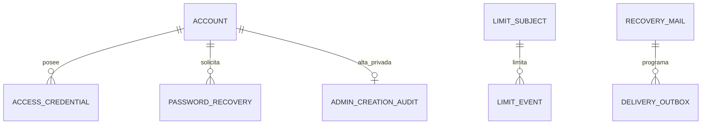

# Modelo de datos: cuentas y acceso

**Fecha**: 2026-11-13. **Base**: [spec.md](spec.md), [decisiones confirmadas](research.md) y [plan.md](plan.md).

Es diseño para migraciones Flyway posteriores, no SQL ya implementado. PostgreSQL 18.7 principal, JDBC/SQL parametrizado y transacciones Spring. Identificadores UUID, fechas `timestamptz` en UTC; comparar tiempos reales después de adquirir bloqueos. No hay tablas operativas de restaurantes, pedidos o entregas en este incremento.

## Entidades, campos y restricciones

### 1. `accounts.account`

| Campo | Tipo / regla |
| --- | --- |
| `id` | UUID, PK estable generado en servidor. |
| `email_normalized` | varchar(254), obligatorio, UNIQUE; trim exterior y minúsculas con Locale.ROOT. La misma normalización en todos los flujos. |
| `display_name` | varchar(100), obligatorio; 1 a 100 puntos de código Unicode después de trim exterior. |
| `role` | varchar con CHECK: CLIENT, RESTAURANT, COURIER o ADMIN; exactamente uno. |
| `access_enabled` | boolean obligatorio; alta habilitada. Restricción independiente de aprobación comercial. |
| `password_hash` | texto obligatorio con identificador de algoritmo, parámetros y sal; nunca contraseña legible. |
| `credentials_version` | bigint >=1; se incrementa al restablecer contraseña para invalidar credenciales previas. |
| `created_at`, `updated_at` | Fechas de creación y última modificación. |

Índice único por correo; no unicidad compuesta correo/rol. Un alta duplicada no sobrescribe nombre, hash, rol ni estado. No incluir `approved`, solicitud comercial, teléfono, dirección, avatar ni medios de pago. El perfil solo puede actualizar `display_name`/`updated_at`. Cambiar rol/estado no tiene operación pública o personal; los estados negativos se preparan mediante fixtures de prueba, no con endpoints de gestión ficticios.

### 2. `accounts.access_credential`

| Campo | Tipo / regla |
| --- | --- |
| `id` | UUID PK. |
| `account_id` | FK a cuenta, obligatorio. |
| `token_digest` | bytea UNIQUE de 32 bytes, SHA-256 de token CSPRNG de 32 bytes; no guardar token original. |
| `credentials_version` | Versión de la cuenta al emitir. |
| `issued_at`, `expires_at` | Caducidad absoluta `issued_at + 8 horas`; sin sliding expiration ni refresh. |
| `revoked_at` | Nulo hasta cierre o recuperación. |

Índices por digest, cuenta y vencimiento. Vigente solo si `revoked_at IS NULL`, hora actual < expiración y versión coincide con cuenta. El estado habilitado de la cuenta se consulta separadamente: credencial válida + cuenta restringida devuelve 403; credencial inválida/expirada/revocada devuelve 401. Las decisiones no se leen de réplica o caché retrasada.

### 3. `accounts.password_recovery`

| Campo | Tipo / regla |
| --- | --- |
| `id` | UUID PK. |
| `account_id` | FK a cuenta. |
| `proof_digest` | bytea UNIQUE de 32 bytes, SHA-256 de prueba aleatoria de 32 bytes. |
| `issued_at`, `expires_at` | Vencimiento exactamente treinta minutos tras emisión. |
| `consumed_at`, `invalidated_at` | Nulos inicialmente; consumo e invalidación se excluyen. |
| `communication_id` | UUID de la comunicación programada mediante contrato; no permite modificar directamente su tabla. |

Índice único parcial por `account_id` donde no está consumida ni invalidada. No usar `now()` dentro del predicado del índice: al crear una nueva recuperación se invalidan las anteriores, incluidas vencidas no marcadas. La caducidad se comprueba al consumir; no exige un job para ser efectiva. Crear recuperaciones no altera contraseña/rol/estado y no emite acceso.

### 4. `accounts.limit_subject`

| Campo | Tipo / regla |
| --- | --- |
| `scope` | LOGIN_EMAIL, LOGIN_ORIGIN, RECOVERY_EMAIL o RECOVERY_ORIGIN. |
| `subject_digest` | HMAC-SHA256 del correo normalizado o dirección de origen canónica con clave externa compartida. |
| `blocked_until` | Solo LOGIN_EMAIL: pausa al alcanzar décimo fallo; no cambia por intentos bloqueados. |
| `last_success_at` | LOGIN_EMAIL: corta la secuencia de fallos previos. |
| `updated_at` | Para limpieza de sujetos sin eventos vigentes ni bloqueos activos. |

PK `(scope, subject_digest)`. La misma clave de pseudonimización se configura en todas las instancias y no se rota durante una ventana activa sin migrar sus contadores. Incluye correos inexistentes sin crear cuentas ni guardar su texto. Origen procede de conexión/proxies confiables, no de una cabecera libre del cliente.

### 5. `accounts.limit_event`

| Campo | Tipo / regla |
| --- | --- |
| `id` | UUID PK. |
| `scope`, `subject_digest` | FK al sujeto. |
| `occurred_at` | Tiempo de evento. |
| `kind` | LOGIN_FAILURE, LOGIN_ATTEMPT o RECOVERY_REQUEST según scope. |

Índice `(scope, subject_digest, occurred_at)`. Tras bloquear sujetos se cuentan eventos en `(ahora - 15 minutos, ahora]`. El login por correo cuenta fallos posteriores al último éxito; los intentos por origen incluyen éxitos y fallos. Recuperación cuenta solicitudes de usuario admitidas, no reintentos de entrega. Una petición bloqueada no se suma ni extiende ventanas/pausas. Conservar al menos eventos vigentes; limpieza de eventos fuera de ventana y sujetos inactivos, sin retener por defecto correos/IP legibles. HMAC no sustituye la protección de claves ni habilita registrar datos sin límite.

| Control | Máximo / efecto |
| --- | --- |
| LOGIN_EMAIL | Décimo fallo consecutivo en quince minutos inicia pausa de quince minutos desde ese fallo. Un éxito anterior al umbral corta la secuencia. |
| LOGIN_ORIGIN | Cien intentos admitidos en cualquier ventana de quince minutos; el 101 se bloquea. |
| RECOVERY_EMAIL | Cinco solicitudes admitidas en cualquier ventana de quince minutos; sexta bloqueada sin sustituir enlace. |
| RECOVERY_ORIGIN | Treinta solicitudes admitidas en cualquier ventana de quince minutos; la 31 se bloquea. |

Los límites por origen y correo se comprueban antes de emitir credencial/recuperación y se consumen juntos para peticiones admitidas. Para login, reservar el intento de origen antes del trabajo de hash; registrar el resultado por correo bajo serialización. Revalidar estado de pausa antes de emitir acceso para resolver carreras entre un éxito y el décimo fallo. Devolver Retry-After sin exponer existencia de cuenta.

### 6. `accounts.admin_creation_audit`

UUID PK; `created_account_id` FK; `operator_identity`, `operator_identity_source`, `created_at`, `operation_id` único y resultado exitoso. Se inserta junto con la cuenta ADMIN desde el modo privado. No almacenar contraseñas, tokens, stdin completo o secretos del entorno. Un fallo de transacción no deja un alta sin su auditoría. Los intentos fallidos pueden registrarse operacionalmente con código y correlación, sin copiar datos sensibles.

### 7. `communications.recovery_mail`

| Campo | Tipo / regla |
| --- | --- |
| `id` | UUID PK entregado a cuentas por contrato. |
| `correlation_id` | UUID opaco de recuperación; no obliga al worker a consultar tablas de cuentas. |
| `status` | PENDING, SENDING, RETRY_WAIT, ACCEPTED, FAILED, CANCELLED o EXPIRED. |
| `encrypted_payload`, `nonce`, `key_id` | Email y enlace necesarios cifrados con AES-256-GCM, nonce único de 12 bytes y tag de 16; clave fuera de base/código. Payload estable por comunicación. |
| `idempotency_key` | Única, estable `password-recovery/{communicationId}`; no contiene prueba ni correo. |
| `expires_at` | Mismo vencimiento que la recuperación; nunca se amplía al reintentar. |
| `attempt_count`, `active_attempt` | Entre cero y cuatro intentos físicos; coordinación con outbox y lease. |
| `lease_until` | Impide envíos paralelos de un mismo intento; recuperable tras caída. |
| `provider_message_id`, `last_error_code` | Referencia/código sanitizado; no cuerpo completo del proveedor. |
| `created_at`, `finished_at` | Auditoría de procesamiento. |

ACCEPTED significa proveedor aceptó el mensaje, no entrega garantizada al buzón. Un correo en vuelo puede llegar después de cancelar; su recuperación ya no autoriza el cambio. Al estado terminal se borran ciphertext/nonce/material reversible; conservar solo identificadores y resultado operativo. Expiración y limpieza también eliminan material que nunca pudo entregarse. Fallar de forma segura si falta la clave, sin generar secretos por defecto.

### 8. `communications.delivery_outbox`

UUID PK; `communication_id` FK; `attempt_number` 1..4; UNIQUE `(communication_id, attempt_number)`; `available_at`, `expires_at`, `published_at`, `publisher_lease_until`, `created_at`. El payload AMQP se deriva solo de identificadores y versión de contrato. Crear intento 1 en la transacción de recuperación; un fallo temporal crea el siguiente junto al estado RETRY_WAIT de la comunicación.

El publicador reclama filas pendientes mediante `FOR UPDATE SKIP LOCKED`/lease, publica con confirm y marca `published_at` solo después de confirmar. Una caída puede duplicar el evento: el worker verifica intento, estado y lease antes de enviar. Si cae después de aceptar Resend, el reenvío utiliza el mismo payload e idempotency key y no un nuevo intento lógico. No se introduce una transacción distribuida con broker/proveedor.

## Relaciones

`PASSWORD_RECOVERY.communication_id` referencia por contrato la comunicación; su cancelación usa `communications.api`. Comunicaciones no tiene dependencia inversa al módulo de cuentas. Los futuros restaurantes se asociarán a la cuenta existente en RF-05/RF-06; su cardinalidad y tabla no se inventan aquí.

## Transiciones e invariantes transaccionales

| Operación | Bloqueos / efectos confirmados juntos |
| --- | --- |
| Alta pública/privada | Normalizar/validar, insertar cuenta con rol fijado; índice único decide duplicados concurrentes. Alta privada añade auditoría en la misma transacción. |
| Login | Verificar hash y capturar versión; bajo bloqueo de sujeto/cuenta volver a comprobar pausa, versión/hash y estado antes de insertar credencial. Si cambió el hash por reset, no emitir token con la verificación anterior. |
| Cerrar acceso | Marcar revocación de la credencial actual; confirmar antes de responder y borrar cookie. Otros dispositivos siguen vigentes salvo reset. |
| Nueva recuperación | Sujetos de límite en orden estable, cuenta bloqueada; invalidar recuperaciones previas y cancelar sus comunicaciones por contrato; insertar recuperación, nueva comunicación y outbox. Todo o nada. |
| Restablecer | Resolver proof digest, bloquear cuenta y recuperación en orden estable; validar de nuevo vencimiento/consumo; actualizar hash, consumir prueba, incrementar versión, revocar accesos y cancelar comunicación en la misma transacción. |
| Editar perfil | Cuenta bloqueada con propietario/estado vigentes; actualizar solo nombre. Último commit de una edición válida prevalece para ese único campo. |
| Reservar/reintentar envío | Bloquear comunicación, validar intento/estado/lease y vencimiento; tras fallo temporal incrementar presupuesto y crear siguiente outbox juntos. No tocar tablas de cuenta desde el worker. |

Orden global: sujetos por scope/digest ordenados, cuenta, recuperación, comunicación; las operaciones que no necesitan alguno no adquieren su bloqueo. El worker solo adquiere comunicación/outbox y nunca bloquea cuenta después. Los locks se mantienen por la transacción, sin mantenerlos durante llamadas a Resend. Ante fallo de PostgreSQL no se concede acceso usando estado de memoria; devolver indisponibilidad sin cambios.

Pruebas de integración deben cubrir dos conexiones contendientes, login frente a reset, emisión de recuperación frente a consumo, cambio de restricción frente a actualización y cancelación mientras el worker procesa. Verificación de perfil de otro titular: 403 y filas de ambas cuentas intactas. La inspección de persistencia no debe permitir reutilizar pruebas de recuperación sin la clave externa de cifrado del material de envío.
